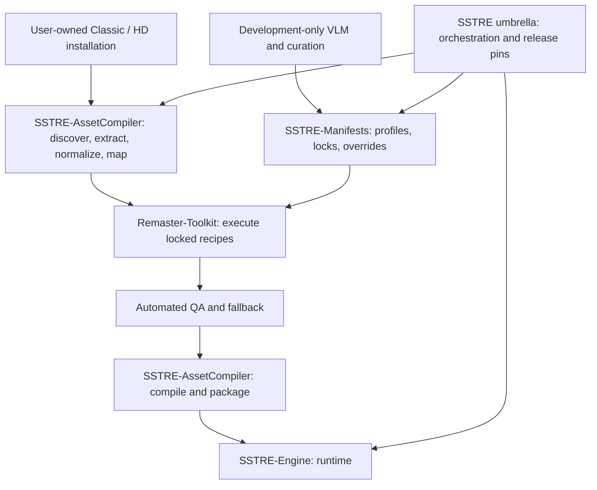

# Architecture overview

**Status:** Phase 0 (bootstrap and research). Nothing described here is implemented yet. This document describes the *intended* structure and its binding constraints. Implementation choices that are still open are marked as such and are tracked in [ADRs](../adr/) and [research dossiers](../research/).

## Goals and constraints

The binding requirements below come from the [project plan](../project-plan.md) §3:

- Targets are Serious Sam: The First Encounter (TFE) and The Second Encounter (TSE). TFE is proven first.
- Development and asset generation are PC-first. Any future console runtime consumes pre-built, platform-specific assets and does no AI inference.
- Original gameplay, levels, enemy behavior and recognizable art direction are preserved by default.
- Existing open-source engine and renderer work is reused.
- HD remaster textures and materials are the preferred source where compatible and legally appropriate. Classic assets are the fallback.
- The reusable toolkit is kept separate from game-specific adapters, manifests and the engine ([ADR-0001](../adr/0001-repository-separation.md)).
- Release builds need no live LLM or AI API ([ADR-0003](../adr/0003-dev-release-separation-locked-recipes.md)).
- Bulk processing is automated, and curation is driven by exceptions ([ADR-0004](../adr/0004-exception-driven-curation.md)).
- Asset builds are reproducible and versioned, with locked dependencies and incremental caching.
- Ray/path tracing is a target. A non-RT path is kept or investigated for portability.
- Proprietary game data never enters source control or CI ([ADR-0002](../adr/0002-local-user-supplied-assets.md)).

## Data flow

## Components and boundaries

| Component | Owns | Must not |
|---|---|---|
| [SSTRE](https://github.com/Handelsonderneming-S-D-Broekhoven/SSTRE) (umbrella) | docs, ADRs, research, cross-repo schema proposals, release pins, future user-side builder | duplicate implementation that belongs in another repo |
| [SSTRE-Engine](https://github.com/Handelsonderneming-S-D-Broekhoven/SSTRE-Engine) | engine fork, renderer(s), game compatibility, platform ports | depend on Python, ComfyUI or an inference service; link GPL-3.0-only code |
| [SSTRE-AssetCompiler](https://github.com/Handelsonderneming-S-D-Broekhoven/SSTRE-AssetCompiler) | Serious Sam-specific adapters: edition detection, archive extraction, format conversion, HD→Classic mapping, runtime packaging | embed generic processing logic that belongs in the toolkit |
| [SSTRE-Manifests](https://github.com/Handelsonderneming-S-D-Broekhoven/SSTRE-Manifests) | declarative recipes, mappings, material profiles, overrides, generated locks | contain executable code (by default) or asset content |
| [Remaster-Toolkit](https://github.com/Handelsonderneming-S-D-Broekhoven/Remaster-Toolkit) | game-agnostic SR/diffusion execution, QA, caching, PBR derivation, curation tooling | import or reference Serious Sam-specific code, names or formats |

Interfaces between repositories are **files plus documented CLIs**, run as separate processes. They are specified in [cross-repo contracts](cross-repo-contracts.md) and in the JSON Schema proposals under [`schemas/`](../../schemas/).

## Asset pipeline contract (draft)

1. Detect the game edition, validate source hashes, and extract to a local workspace outside any repository.
2. Build an inventory: type, dimensions, color space, alpha, tileability, source path, dependencies and a stable identifier. Deduplicate without losing semantic metadata (`schemas/asset-inventory.schema.json`).
3. Map HD assets to Classic runtime targets. Record unmatched or ambiguous assets.
4. *Development only:* classify assets, generate recipes and candidates, score and curate, then freeze recipes and model identifiers.
5. *Release:* run the fixed recipes. Super-resolution runs first. Controlled diffusion is optional and is not applied blindly to technical textures, text, HUD, normal maps or masks (`schemas/asset-recipe.schema.json`).
6. Validate seams, alpha, structure, color, perceptual difference and dimensions. Fall back conservatively and record failures.
7. Produce coherent PBR maps where the renderer supports them. Inferred maps are labelled as inferred, never as measured.
8. Generate mipmaps, compress and package for the runtime profile. Record output hashes and provenance (`schemas/build-provenance.schema.json`).

## Open architectural decisions

These are tracked in the plan §3 "Open decisions" list. Each is assigned to a dossier:

| # | Decision | Dossier | ADR |
|---|---|---|---|
| 1 | Engine base (RT-first vs Classic-VK-first) | [RD-001](../research/RD-001-engine-baseline.md) | [ADR-0005](../adr/0005-engine-foundation.md) (proposed) |
| 2 | Supported editions and HD mapping feasibility | [RD-002](../research/RD-002-hd-assets.md) | — |
| 3 | AI models and workflows | [RD-003](../research/RD-003-ai-pipeline.md) | — |
| 4 | Determinism limits and tolerances | [RD-004](../research/RD-004-reproducibility.md) | — |
| 5 | PBR, animation, cubemap and metadata representation | [RD-005](../research/RD-005-rendering.md) | — |
| 6 | Backends, shader toolchain, compression and packaging per platform | [RD-005](../research/RD-005-rendering.md), [RD-006](../research/RD-006-platforms.md) | [ADR-0007](../adr/0007-platform-strategy.md) (partly proposed) |
| 7 | Console legal and technical constraints | [RD-006](../research/RD-006-platforms.md), [RD-007](../research/RD-007-licensing.md) | [ADR-0007](../adr/0007-platform-strategy.md) |
| 8 | GUI, CLI framework, database, containers, CI matrix, release format | [RD-008](../research/RD-008-testing-release.md) | — (minimal scaffolding until evidence exists) |

Licensing boundaries are covered by [ADR-0006](../adr/0006-licensing-boundaries.md) (proposed) and [RD-007](../research/RD-007-licensing.md).
