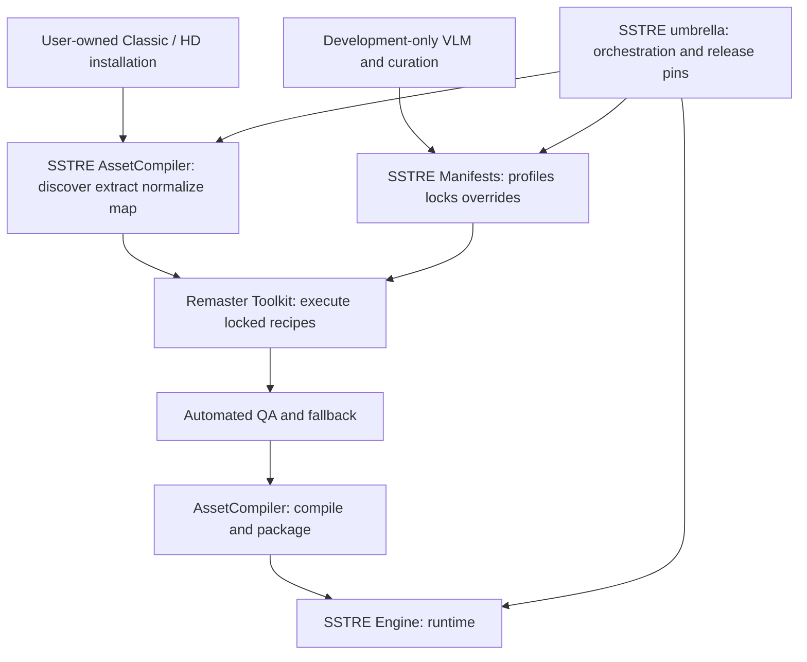

# SSTRE — Serious Sam: The Raytraced Encounter
## Project bootstrap and research mandate for Claude Code

**Version:** 0.1 | **Status:** Pre-development | **Owner:** Handelsonderneming S.D. Broekhoven / ITEagle

## 1. Mission and scope

Build an unofficial, open-source modernization of Serious Sam: The First Encounter (TFE) and The Second Encounter (TSE), preserving the original campaigns, gameplay and recognizable art direction. Use existing open-source engine work wherever feasible; enhance visuals with ray/path tracing, PBR materials and AI-assisted texture reconstruction; eventually investigate modern console ports. Build a reusable remaster toolkit rather than a one-off conversion script.

This assignment is **Phase 0: repository bootstrap and research**, not implementation of the entire remaster. Establish documentation, licensing boundaries, repository scaffolding, architectural decision records (ADRs), research dossiers and a prioritized proof-of-concept backlog. Do not present planned features as implemented.

The project is independent of Croteam and Devolver Digital. Users supply their own legally acquired game data. Do not commit or distribute original game assets, extracted assets, generated derivatives, proprietary SDKs, secrets or model weights during this assignment. Local processing does not automatically establish legal permission; investigate applicable terms before distribution.

## 2. Repository registry and ownership

All repositories are under `Handelsonderneming-S-D-Broekhoven` (do not substitute a guessed ITEagle GitHub organization).

| Repository | Responsibility | Intended licensing |
|---|---|---|
| [SSTRE](https://github.com/Handelsonderneming-S-D-Broekhoven/SSTRE) | Umbrella project, documentation, release orchestration, eventual user-facing builder and packaging | GPL-3.0-only for original project code, subject to dependency audit |
| [SSTRE-Engine](https://github.com/Handelsonderneming-S-D-Broekhoven/SSTRE-Engine) | Engine fork, rendering, game compatibility, runtime, platform ports | Preserve upstream licenses and notices; do not relicense |
| [SSTRE-AssetCompiler](https://github.com/Handelsonderneming-S-D-Broekhoven/SSTRE-AssetCompiler) | Serious Sam-specific asset discovery, extraction, mapping, conversion and compilation | GPL-3.0-only for independent original code, subject to dependency audit |
| [SSTRE-Manifests](https://github.com/Handelsonderneming-S-D-Broekhoven/SSTRE-Manifests) | Game-specific asset recipes, mappings, generated lock manifests and curated overrides | GPL-3.0-only proposed for original contributions; verify suitability for data and third-party content |
| [Remaster-Toolkit](https://github.com/Handelsonderneming-S-D-Broekhoven/Remaster-Toolkit) | Game-agnostic texture processing, workflow execution, QA, caching, material generation and eventual curation tools | GPL-3.0-only for original independent code, subject to dependency audit |

Licensing convention: GPLv3 is the intended baseline for new independent repositories, not a blanket relicensing of third-party code. `GPL-3.0-only` is the proposed SPDX interpretation; confirm with owner before changing any existing license. Preserve upstream engine license text and file-level notices verbatim. GPL-2.0-only and GPL-3.0-only cannot simply be combined into one derivative executable; a vendor folder or submodule does not cure incompatibility. Keep engine and independent build tools separate processes, exchanging files and documented CLI interfaces. Assess actual coupling and distribution obligations. Record unresolved questions rather than claiming legal clearance.

## 3. Architecture: settled direction versus open decisions

### Settled project requirements

- Both TFE and TSE are ultimate targets; prove TFE first if necessary.
- PC-first development and PC-side asset generation. Console runtime consumes prepared platform-specific assets; no requirement to run AI inference on consoles.
- Original gameplay, levels, enemy behavior and recognizable visual identity should remain intact by default.
- Reuse existing engine and renderer work rather than rebuilding from scratch without evidence.
- Prefer the existing HD remasters as texture/material source where compatible and legally appropriate; retain Classic assets as fallback. Do not assume HD levels, models, shaders or formats can be imported directly into SE1.
- Separate reusable toolkit from game-specific adapters, manifests and engine.
- Development-time vision LLM may classify, generate prompts and propose recipes; release builds must not require a live LLM or external AI API.
- Automated bulk processing is the default; curate only prominent assets and exceptions. Target 95% or more automated acceptance as an aspirational metric, not a proven result.
- Reproducible, versioned asset builds, locked dependencies and incremental caching are core requirements.
- Ray/path tracing is a target feature; maintain or investigate a viable non-RT rendering path for portability.
- Do not require proprietary game data in source control or CI.

### Preferred but not yet approved implementation choices

- Primary engine candidate: https://github.com/sultim-t/Serious-Engine-RT
- Alternative foundation: https://github.com/tx00100xt/SeriousSamClassic-VK
- Other references: https://github.com/Croteam-official/Serious-Engine ; https://github.com/sultim-t/Serious-Engine-Vk ; https://github.com/sultim-t/RayTracedGL1
- Python orchestration, ComfyUI or a headless equivalent, PyTorch, Real-ESRGAN/SwinIR, SDXL and compatible tiled conditioning, a vision-language model such as Qwen-VL. Benchmark before selection; verify actual availability, compatibility and licenses.
- Windows/Linux host support; Vulkan-first renderer candidate; CMake where compatible with upstream; JSON/YAML recipes, DDS/KTX2 runtime formats, PNG/TIFF/EXR intermediates where appropriate.
- Git submodules or explicitly pinned repository revisions for orchestration; prefer simple interfaces over a tightly coupled monorepo.

### Open decisions (research, do not silently finalize)

1. Which engine is the best base after examining source, buildability, upstream divergence, TSE support and renderer coupling? If RT-first is poor for portability, evaluate Classic-VK-first with RT as optional backend.
2. Which game editions and asset hashes are supported? Is HD asset mapping feasible at texture, model, UV, material and shader levels? What conversion is necessary?
3. Which AI models/workflows preserve structure, alpha, tiling and art direction best, at acceptable compute cost?
4. How much bit-level determinism is possible across GPU architectures, drivers and libraries? Define reference environment and tolerances from measurements.
5. How to represent PBR maps, texture animation, cubemaps, masks, color spaces and engine-specific metadata without loss?
6. Which rendering backends, shader toolchains, texture compression and asset packaging are appropriate per target platform?
7. What are the actual legal and technical constraints for console development, distribution and game asset conversion? Xbox Series X/S, PS5, Switch/Switch 2 are research targets, not promised ports; Vita is optional low priority.
8. Whether to implement GUI, CLI framework, database, container strategy, CI matrix and release format; use minimal scaffolding until evidence exists.

## 4. System design and data flow



Dependency direction: generic toolkit must not import Serious Sam-specific code. AssetCompiler owns game-specific adapters and runtime format conversion, invokes generic toolkit. Manifests contain declarative data, not executable code by default. Engine loads compiled assets and must not depend on Python, ComfyUI or a live inference service. Umbrella coordinates pinned releases, install/build UX and documentation. Avoid duplicating implementation across repos.

### Asset pipeline contract (draft)

1. Detect game edition, validate source hashes; extract to local workspace.
2. Inventory asset types, dimensions, color space, alpha, tileability, source path, dependencies and stable identifiers; deduplicate carefully without losing semantic metadata.
3. Map HD assets to Classic runtime targets; document unmatched or ambiguous assets.
4. Development only: classify and generate recipes; optionally generate multiple candidates, score and curate. Freeze resolved recipes and workflow/model identifiers.
5. Release: run fixed recipes, regular super-resolution first where appropriate, optional controlled diffusion for additional detail. Technical textures, text, HUD, normal maps and masks should not be blindly sent through diffusion.
6. Validate seam continuity, alpha, structural fidelity, color, perceptual differences and dimensions. Metrics such as SSIM/LPIPS are signals, not proof of correctness. Fall back to conservative processing or original asset if necessary; record failures.
7. Produce coherent PBR maps when supported; do not claim inferred roughness/normal maps are physically measured. Respect original lighting and metadata.
8. Generate mipmaps, compress and package for selected runtime profile; record output hashes and provenance.

### Reproducibility requirements

- Resolve recipes using precedence: curated override > generated per-asset recipe > material profile > global defaults. Freeze the effective configuration for release builds.
- Record source file hash, stable asset ID, prompt and negative prompt, seed, model/checkpoint/VAE/conditioning hashes, workflow revision, sampler, scheduler, steps, denoise, precision, scaling, tiling, post-processing and compressor settings.
- Pin dependency versions, custom node revisions, container digest where used, and reference hardware/driver/runtime details. Disable nondeterministic kernels where feasible; document exceptions.
- Canonicalize manifest serialization and use unambiguous content-addressed cache keys covering input bytes, resolved recipe, dependency/workflow identity, runtime and target profile. Never treat a seed alone as sufficient.
- Define reference builds with byte-level hash checks only once demonstrated. For other supported environments use explicitly documented equivalence tests and thresholds; do not promise identical outputs on arbitrary GPUs.
- No mutable network model aliases or live prompt generation in release builds. Verify downloads against expected hashes and record provenance. Never auto-execute untrusted custom nodes without review.
- Resume interrupted jobs, report fallback decisions, and invalidate only affected assets when recipes change.

## 5. Mandatory multi-agent execution plan

Use Claude Code's actual subagent/Agent capability if available. Lead agent coordinates; delegate independent research in parallel, then integrate findings. If subagents are unavailable, explicitly report that limitation and execute sequential work packages; do not simulate agent results or claim delegation occurred.

| Agent | Scope and concrete deliverables |
|---|---|
| A — Engine auditor | Compare RT, official, Vulkan and Classic-VK forks; inspect actual source, license headers, build systems, TFE/TSE support, rendering boundaries, platform coupling; produce `RD-001-engine-baseline.md` and engine recommendation. |
| B — Asset format researcher | Investigate Classic/HD archives, texture/model/material formats, UV compatibility, mapping and local extraction; produce `RD-002-hd-assets.md`, proposed inventory schema and a 50-asset test matrix. |
| C — AI and deterministic build researcher | Evaluate models and workflows, repeatability constraints, tiling, alpha, quality metrics, caching and fallback; produce `RD-003-ai-pipeline.md`, `RD-004-reproducibility.md` and benchmark plan. |
| D — Renderer/platform researcher | Investigate existing RT library, raster fallback, TSE rendering, PBR, Windows/Linux and realistic console toolchain paths; produce `RD-005-rendering.md`, `RD-006-platforms.md`. |
| E — Licensing/compliance researcher | Examine actual repository and dependency licenses, per-file exceptions, GPL compatibility, asset/model terms, attribution and branding; produce `RD-007-licensing.md`, draft notices policy and unresolved legal questions. |
| F — Repository bootstrap engineer | Inspect all five repositories, current branches/files/license status; propose scaffolds, minimal CI, contribution conventions and cross-repo contracts. Own scaffold edits after lead approves licensing boundaries. |
| G — QA/release researcher | Define acceptance gates, reproducibility checks, performance/gameplay regression strategy and release compatibility matrix; produce `RD-008-testing-release.md` and draft POC backlog. |

Agents A–E and G initially operate read-only; return findings and proposed changes to lead or separate worktrees. Agent F must not change licenses or overwrite existing files before lead reviews current repository contents. Assign explicit non-overlapping paths for any delegated edits. Lead resolves contradictions, reviews diffs and integrates documentation. Preserve evidence and distinguish observed facts from hypotheses. Do not execute untrusted repository scripts merely to inspect them.

## 6. Research dossier format

Place canonical dossiers in umbrella `docs/research/`. Each must contain: question and scope; date and status; evidence with URLs and exact commits/file paths when available; observed facts; assumptions and unknowns; alternatives and tradeoffs; risks; proposed experiment and measurable success criteria; recommendation; decision dependencies; next steps. Use primary upstream sources; mark inaccessible/private content and failed build attempts. Never invent versions, benchmark results or license conclusions.

## 7. Bootstrap directory layout (proposed, adapt to existing files)

```text
SSTRE/
  README.md  LICENSE  THIRD_PARTY_NOTICES.md  CONTRIBUTING.md  SECURITY.md
  docs/architecture/overview.md
  docs/adr/0000-template.md
  docs/research/                 # canonical RD-001..008
  docs/roadmap.md
  docs/repository-registry.md
  docs/compatibility.md
  docs/backlog.md
  schemas/                       # cross-repo contract proposals
  scripts/                       # only useful bootstrap scripts
  .github/ISSUE_TEMPLATE/
  .github/workflows/
SSTRE-Engine/
  [preserved upstream source layout and license]
  docs/sstre/                    # project-specific integration notes
SSTRE-AssetCompiler/
  src/sstre_assetcompiler/       # adapter boundaries, no fake implementation
  tests/fixtures/                # synthetic or licensed fixtures only
  docs/  README.md  LICENSE
SSTRE-Manifests/
  schemas/  defaults/  materials/  mappings/
  games/tfe/  games/tse/
  overrides/  generated/  docs/  README.md  LICENSE
Remaster-Toolkit/
  src/remaster_toolkit/
  tests/fixtures/  workflows/  docs/  README.md  LICENSE
```

Use minimal files that have an actual purpose. Do not add empty folders, redundant docs or placeholder classes pretending to work. Use language-neutral interfaces until implementation choices are settled. Add `.gitignore` for game data, build artifacts, model caches and secrets. Do not use Git LFS to upload restricted assets. Keep engine fork history intact; if existing engine repo is empty or unrelated, document how to import upstream preserving history and request approval before destructive history changes.

Every README should include project status, scope/non-goals, repository role, architecture/dependencies, prerequisites (known versus TBD), current development instructions that actually work, licensing/third-party notices, links to sibling repositories and contribution guidance. No fake badges, release claims or unsupported compatibility promises. Use English for project files.

### Initial ADRs

Record decisions separately from research: ADR-001 repository separation (accepted); ADR-002 local user-supplied assets (accepted project policy, not legal clearance); ADR-003 development/release separation and locked recipes (accepted); ADR-004 exception-driven curation (accepted); ADR-005 engine foundation (proposed); ADR-006 licensing boundaries (proposed pending audit and owner confirmation); ADR-007 platform strategy (PC-first accepted, specific backends/console support proposed). Include context, decision, alternatives, consequences and status. Do not mark an unresolved technical choice accepted.

## 8. Development roadmap and gates

| Phase | Objective | Exit gate |
|---|---|---|
| 0 | Bootstrap and evidence-based research | Five repo roles documented; license boundaries reviewed; dossiers/ADRs and POC backlog available |
| 1 | Engine baseline | Selected engine builds and launches TFE on reference PC; gameplay/performance baseline captured; TSE support assessed |
| 2 | Asset extraction and mapping | Representative Classic/HD assets extracted locally, mapped and successfully round-tripped or fallback documented |
| 3 | AI toolkit prototype | 50 representative textures processed; deterministic reruns measured; QA, provenance and caching demonstrated |
| 4 | First full texture build | Required assets covered with explicit fallback; high-priority/problem textures reviewed; full build does not stall on individual failures |
| 5 | PBR integration | Coherent maps and correct material behavior shown in engine on representative surfaces |
| 6 | Rendering and TSE compatibility | Both campaigns supported with selected rendering path; ray tracing and raster fallback investigated/implemented according to approved ADRs |
| 7 | PC alpha | Full campaign playtests, co-op/multiplayer regression where applicable, performance and memory profiles; user-side builder tested |
| 8 | Console feasibility and ports | Only platforms with viable authorized toolchains, runtime support and distribution path progress to port implementation |
| 9 | Public stable release | Pinned multi-repo release, validated local build instructions, documented compatibility, notices and issue reporting |

Phases 1–3 may overlap after Phase 0. Earlier rendering/TSE spikes may be needed to validate engine selection. Console work is optional and must not block a viable PC release. No fixed calendar or budget is approved; estimate after POC. Future games are outside current delivery scope.

### Post-demonstration stages (owner directive 2026-11-28)

After the demonstration build (0.1.0-preview2) the order of work is: **Demonstration Build → Performance Optimization → PBR & Hex-Tiling → Geometry Enhancement → Native Controller Support → Multicontroller & Split-Screen → Console Ports.** The [roadmap](roadmap.md) maps these to stages M0–M6 with entry and exit criteria, and the [backlog](backlog.md) lists the work packages (POC-33..63). The phase table above stays valid as a list of capabilities; its order is governed by the stages.

| Stage | Exit criterion (summary) |
|---|---|
| M1 Performance | Four-way RT benchmark (original Serious-Engine-RT; SSTRE RT with original assets; with the upscaled pack; optimized) at 2560×1440 on TFE and TSE incl. combat; ≈100 FPS on an RTX 4070 with RT, high settings and the upscaled pack, frame generation excluded, or the stop rule escalated to the owner; 0 Vulkan validation errors; no silent quality reductions ([RD-014](research/RD-014-rt-performance.md)) |
| M2 PBR & hex-tiling | Coherent PBR maps with automated QA, packing and quality profiles; generic, optional hex-tiling in RTGL1; every feature benchmarked against the M1 baseline ([RD-011](research/RD-011-hex-tiling.md)) |
| M3 Geometry | Optional normal smoothing, terminator correction, selective subdivision, displacement; collision and gameplay unchanged ([RD-013](research/RD-013-geometry-enhancement.md)) |
| M4 Controller | PC fully usable without keyboard and mouse; Steam Input and Steam Deck validated ([RD-012](research/RD-012-input-local-multiplayer.md)) |
| M5 Multicontroller | Per-player devices and 4-player split-screen; RT split-screen feasibility measured |
| M6 Consoles | Research only ([RD-009](research/RD-009-ps5-homebrew.md), [RD-010](research/RD-010-homebrew-distribution.md), ADR-0007) |

### First POC backlog (after bootstrap)

- Build RT and alternative engine candidates without modifying upstream first; document failures and exact revisions.
- Inventory locally available game versions; obtain user-provided installations if missing, without downloading unauthorized copies.
- Select 50 textures spanning architecture, terrain, vegetation, enemies, weapons, UI, alpha, normal maps and technical masks.
- Demonstrate HD-to-Classic mapping and import into a representative level; fall back to Classic assets if incompatible.
- Benchmark conventional upscaling versus controlled diffusion, including GPU time, VRAM, visual fidelity and seams.
- Rebuild identical inputs twice on reference environment; compare hashes and perceptual differences; test incremental invalidation.
- Capture baseline versus remastered screenshots locally, runtime memory and performance; no restricted images in public repos.
- Write a go/no-go recommendation for engine base, asset source strategy, model choices and next sprint.

## 9. Execution safety and repository workflow

1. Inspect local checkout and remotes first. Check `git status`, branches, existing history and license files. Do not assume the linked repositories are empty or accessible.
2. Clone or inspect only using available authorized credentials. Do not ask for tokens in plaintext or expose credentials. If access is unavailable, produce local scaffold proposals and record blockers.
3. Start agents with scope and deliverables above. Review evidence before editing architecture or license decisions.
4. Work on dedicated bootstrap branches/worktrees; preserve unrelated user changes. Do not force-push, rewrite history, delete files, change repository visibility, publish releases or modify upstream projects.
5. Add correct license texts only after checking existing licensing and the approved baseline. Do not manufacture copyright ownership or third-party notices. Where the owner choice is unresolved, provide a proposal instead of silently changing the license.
6. Add CI only for actual checks: Markdown/schema validation, lint or tests that exist, and synthetic fixtures. No jobs requiring game files or expensive GPU access by default. Pin third-party actions where practical and use least privilege.
7. Validate relative links, Markdown, schemas, dependency direction, license boundaries, and repo consistency. Run available tests and record commands/results honestly.
8. Prepare commits/PR descriptions locally; do not push or open PRs without explicit authorization. If the owner has explicitly authorized remote changes in the execution session, follow that scope and prefer reviewable PRs.

## 10. Required end-of-bootstrap report

Return a concise per-repository table of branch, changed files, checks executed and status; actual subagents used and their findings; accepted/proposed ADRs; highest-risk open issues; links/paths to eight dossiers; prioritized next sprint and estimated effort with assumptions; any inaccessible repos, missing game data, failed tests or unverified claims. Include a summary of changes requiring owner approval, especially licensing, engine selection, fork history and platform targets. Stop after Phase 0 unless the owner separately authorizes implementation.

**Definition of done:** a new contributor can understand the project, locate the five repositories, distinguish fixed requirements from undecided technologies, identify the evidence behind recommendations, and start the next POC sprint without assuming any feature or platform is already working.
